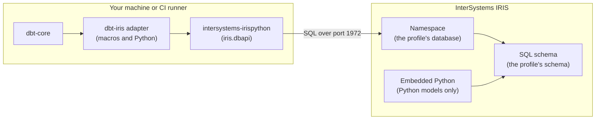
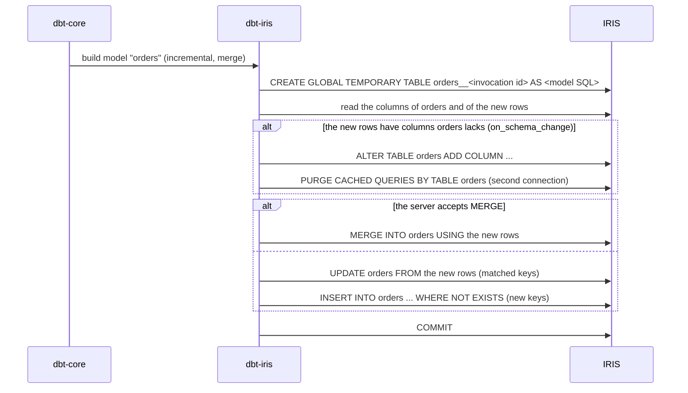

# How dbt-iris works

dbt-iris is the adapter that lets dbt build models in InterSystems IRIS. dbt compiles your models
to SQL; the adapter turns that SQL into statements IRIS accepts, sends them through the
InterSystems Python driver, and keeps track of the tables and views it has built. This page
explains what happens on each side, so that what you see in IRIS makes sense.

## The pieces

- **dbt-core** reads your project, compiles each model to SQL and decides the order to build
  them in.
- **The adapter** (`dbt-iris`) supplies the IRIS versions of dbt's macros (how to create a table,
  run a merge, take a snapshot) and the Python code that talks to the driver. It is the only part
  that knows IRIS.
- **The driver** (`intersystems-irispython`, installed with the adapter) carries SQL to the IRIS
  superserver, port 1972 by default, and rows back.
- **IRIS** runs every statement. Models are built in the namespace the profile's `database`
  names, in the SQL schema the profile's `schema` names.
- **Python models** are the exception to "SQL over the wire": the adapter creates a stored
  procedure that runs the model's code inside IRIS, in Embedded Python, and drops it afterwards.
  The data never leaves the server.

## Names

| In dbt              | In IRIS                                                                             |
| ------------------- | ----------------------------------------------------------------------------------- |
| `database`          | A namespace, such as `USER`. Not an IRIS database, which is a namespace's data file |
| `schema`            | A SQL schema: the part before the dot in `schema.table`                             |
| A model             | A table or a view in that schema, named after the model                             |
| `materialized_view` | A table rebuilt on every run, or a view; IRIS has no materialized views             |

IRIS creates a schema when its first table is created, so `dbt run` on a new schema needs no
separate step. See [IRIS SQL differences](iris-sql.md) for how IRIS SQL treats names and case.

## What each materialization becomes

| Materialization     | What the adapter does in IRIS                                                                                                                                                                                                             |
| ------------------- | ----------------------------------------------------------------------------------------------------------------------------------------------------------------------------------------------------------------------------------------- |
| `view`              | `CREATE VIEW`. IRIS has no `ALTER VIEW ... RENAME`, so a rename recreates the view from its definition                                                                                                                                    |
| `table`             | `CREATE TABLE <model>__<invocation id> AS <model SQL>`, then renames the old table to a backup, renames the new one into place and drops the backup. Readers never see a half-built table                                                 |
| `incremental`       | The first run creates the table from the model SQL. Later runs build the new rows into a global temporary table, then apply the strategy: `append`, `merge`, `delete+insert` or `microbatch`. `--full-refresh` rebuilds it like a `table` |
| `ephemeral`         | No object in IRIS. The model becomes a CTE in the models that use it; the adapter moves CTEs to where IRIS accepts them                                                                                                                   |
| `materialized_view` | A table rebuilt on every run (the default) or a view, chosen with `iris_materialized_view_as`                                                                                                                                             |
| seeds               | `CREATE TABLE` with a column type inferred from the CSV (or `column_types`), then the rows in batches                                                                                                                                     |
| snapshots           | A `HASH()` SQL function, installed once per schema, identifies each version of a row; changed rows are closed with an `UPDATE` and new versions added with an `INSERT`                                                                    |
| tests               | A `SELECT` that returns the failing rows. dbt counts them                                                                                                                                                                                 |
| Python models       | A temporary `LANGUAGE PYTHON` stored procedure runs the model in Embedded Python and writes the table with `pandas` and `sqlalchemy-iris`                                                                                                 |

Every temporary, intermediate and backup table name carries the dbt invocation id, so two
`dbt run` processes never share one. A global temporary table's rows belong to the connection
that wrote them and disappear with it; its definition stays in the schema.

## An incremental run, step by step

## What the adapter checks before it sends SQL

IRIS SQL differs from other warehouses in a few places where the result would be an error or,
worse, wrong data. The adapter handles these itself, so a project written for another warehouse
needs as few changes as possible.

- **What the server accepts.** Once per server, the adapter asks whether IRIS accepts `MERGE`
  and `WITH RECURSIVE`, with probes that change nothing. `merge` uses `MERGE` when it can. A model
  with `WITH RECURSIVE` on a server without recursive CTEs fails before it runs, with a message
  naming the IRIS version.
- **CTEs where IRIS refuses them.** IRIS does not accept a `WITH` clause inside a subquery, or
  one CTE nested inside another. The adapter moves them to the top of the statement.
- **UNIONs that IRIS would store wrongly.** Before building a table from a `UNION`, the adapter
  reads each branch's column types. A column that is `DATE` or `TIME` in one branch and another
  type in another fails the model with a message, because IRIS would store the dates as numbers.
- **Column numbers in `GROUP BY`.** IRIS reads `GROUP BY 1` as the constant 1, so the adapter
  refuses it with a message instead of returning one group.
- **Locks held by another process.** DDL that meets another process's class lock is retried.
- **Cached queries after a column change.** After adding or dropping columns, the adapter clears
  the table's cached queries, so a query another connection prepared earlier does not fail.
- **The `HASH()` function for snapshots** is installed when a schema is created. A user without
  the `%Developer` role cannot install it; dbt warns and runs everything except snapshots and
  Python models.

## Where to go next

- [Tutorial](tutorial.md): build the example project from scratch.
- [Configuration](configuration.md): every profile setting and model config.
- [IRIS SQL differences](iris-sql.md): what to write differently for IRIS.
- [Troubleshooting](troubleshooting.md): the messages you may see, and what to do.
